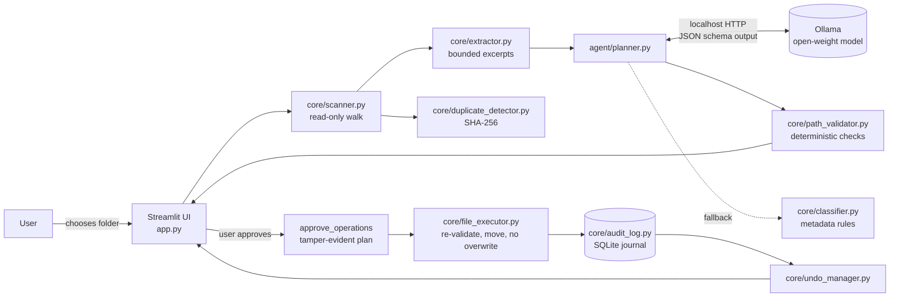

# 🦥 SlothSort

**Stop organizing files manually. Let local AI do the boring work — privately, safely, and reversibly.**

SlothSort is a local-first AI file organization agent. Point it at a messy folder and it scans the files,
reads a small excerpt of each, asks an open-weight model running on *your* machine (via Ollama) for a
category and a clear filename, and shows you the whole plan. Nothing moves until you approve it, nothing
is ever overwritten or deleted, and every move can be undone.

---

## The problem

Downloads and "misc" folders fill up with `doc_001.pdf`, `scan_004.pdf`, `IMG_8291.png` and
`notes_final_v3.txt`. Sorting them means opening every file, working out what it is, renaming it and
dragging it somewhere. Cloud AI tools could help, but they need you to upload private documents such as
bills, receipts and coursework.

## The solution

| Before | After (actual suggestions from a run with `gemma3:4b` on the demo set) |
|---|---|
| `doc_001.pdf` | `Invoices/Greenfield_Power_Electricity_Bill_October_2026.pdf` |
| `invoice_final_2.pdf` | `Invoices/Lumen_Labs_Redesign_Invoice_1042.pdf` |
| `hw3.docx` | `Assignments/CS101_Assignment_3_Sorting_Algorithms.docx` |
| `notes_final_v3.txt` | `Notes/Project_Kestrel_Weekly_Meeting_Notes.txt` |
| `Downloads/download (3).pdf` | `Receipts/Pinecone_Books_Order_Receipt_PB88213.pdf` |

Suggestions depend on the model and the evidence. They are proposals for you to review, not guarantees.

## Features

- **Real local AI**: classification and naming by an open-weight model through Ollama. You pick the model.
  The default is `qwen2.5:3b`; anything you have pulled locally works.
- **Read-only scanning**: PDF (PyMuPDF), DOCX, TXT, MD and CSV text excerpts. For PNG/JPG it reads image
  metadata only (dimensions, format). There is **no OCR or image understanding**.
- **Review before anything happens**: an editable table where you can change the category or filename,
  approve or reject rows, or "select all safe". Planning never touches the disk.
- **Deterministic safety layer**: every model suggestion is re-validated in plain Python. That covers the
  allowed categories, the original extension, absolute paths, `..`, path separators, illegal and reserved
  Windows names, and staying inside the root.
- **Grounding check**: if a proposed name contains a number that isn't in the file (e.g. a guessed year), or
  a word that can't be verified for a file with no readable text, the row is flagged for review.
- **No overwrites, ever**: moves fail rather than replace. Destinations are made unique (`_2`, `_3`) and
  the final name is shown in the preview.
- **Persistent journal and undo**: every attempt (success or failure) is recorded in SQLite. You can undo
  a single move or a whole batch, also after a restart.
- **Exact duplicate detection**: SHA-256, grouped with hash prefixes. Duplicates are reported, never deleted.
- **Graceful degradation**: if Ollama or the model is missing, the app says so and shows setup steps.
  Scanning and duplicate detection still work, and an explicit *metadata rules (no AI)* plan is available.
  Rules results are always labelled `rules` and flagged for review.

## Screenshots

> _Screenshot placeholders: add images to `docs/` after recording the demo._
>
> 1. `docs/01-select.png`: folder selection and Local AI status
> 2. `docs/02-scan.png`: scan table and duplicate groups
> 3. `docs/03-review.png`: AI plan review editor
> 4. `docs/04-approve.png`: approval preview
> 5. `docs/05-results.png`: results, journal and undo

## Architecture



The model can only return JSON text. It cannot run commands or touch files. The executor accepts only an
`ApprovedPlan` built from user-approved rows, and re-checks each operation right before running it: the
source is inside the root, it is unchanged (size, mtime and SHA-256), the destination is inside the root
and doesn't exist, and no folder on the way is a link. If the plan is modified after approval, its
fingerprint stops matching and execution is refused.

```
slothsort/
├── app.py                  Streamlit UI (entry point)
├── config.py               settings (env vars), categories, limits
├── agent/
│   ├── planner.py          Ollama client, batching, retries, validation, grounding check
│   ├── prompts.py          system prompt (file data framed as untrusted)
│   └── schemas.py          Pydantic models for model output and plan items
├── core/
│   ├── scanner.py          read-only walk; skips hidden/temp/symlinks/junctions
│   ├── extractor.py        PDF/DOCX/text excerpts, image metadata
│   ├── duplicate_detector.py
│   ├── classifier.py       rule-based fallback and baseline
│   ├── path_validator.py   filename, category and destination validation
│   ├── file_executor.py    approved-plan execution, no-overwrite moves
│   ├── undo_manager.py
│   └── audit_log.py        SQLite journal
├── demo/
│   ├── generate_demo.py    synthetic messy folder (29 fictional files)
│   ├── evaluate.py         reproducible evaluation
│   ├── eval_labels.json    hand-assigned expected categories
│   └── README.md           demo script
└── tests/                  pytest suite (Ollama mocked)
```

## Technology stack

Python 3.11 · Streamlit · Ollama (local model runtime) · PyMuPDF · Pydantic v2 · Pillow · SQLite · pytest.
The Ollama client uses only the standard library (`urllib`). There is no separate backend, no database
server, no cloud service and no API key.

## Setup

> Installing packages and downloading a model needs internet access once. After that, the workflow runs
> against `localhost` only.

1. **Python 3.11+**

   ```bash
   git clone https://github.com/SHWETANK-SAURABH/slothsort.git
   cd slothsort
   python -m venv .venv
   # Windows: .venv\Scripts\activate     macOS/Linux: source .venv/bin/activate
   pip install -r requirements.txt
   ```

2. **Ollama and a model**

   - Install Ollama from <https://ollama.com/download> and make sure it is running (`ollama serve`, or the
     desktop app).
   - Download the default model (about 1.9 GB):

     ```bash
     ollama pull qwen2.5:3b
     ```

   - To use another local model, either select it in the sidebar or set `SLOTHSORT_MODEL`, e.g.
     `SLOTHSORT_MODEL=gemma3:4b`.

3. **Run**

   ```bash
   streamlit run app.py
   ```

   Open <http://localhost:8501>. The server binds to `localhost` only (see `.streamlit/config.toml`).

### Configuration

| Variable | Default | Meaning |
|---|---|---|
| `SLOTHSORT_MODEL` | `qwen2.5:3b` | Ollama model name |
| `SLOTHSORT_OLLAMA_URL` | `http://localhost:11434` | Ollama endpoint |
| `SLOTHSORT_TIMEOUT` | `120` | seconds per model request |
| `SLOTHSORT_MAX_RETRIES` | `2` | re-prompts for malformed output (bounded) |
| `SLOTHSORT_BATCH_SIZE` | `4` | files per model request |
| `SLOTHSORT_EXCERPT_CHARS` | `1200` | text sent to the model per file |
| `SLOTHSORT_MAX_FILE_MB` | `50` | larger files are not read |
| `SLOTHSORT_MAX_FILES` | `500` | scan cap |
| `SLOTHSORT_REVIEW_THRESHOLD` | `0.6` | below this self-reported confidence, a row needs review |
| `SLOTHSORT_DB` | `.slothsort/journal.sqlite3` | journal location (inside the app folder) |

## Using SlothSort

1. **Select folder**: type or paste a path, use **Browse…** (native picker, works when the app runs on
   your own machine), or **Use demo folder**. Drive roots and your whole home folder are refused.
2. **Scan files**: read-only. Shows type, size, extraction status and duplicate groups.
3. **Review AI plan**: generate with the local model (or rules). Edit the category or filename inline. Use
   *Select all safe suggestions* to tick only valid rows that aren't flagged, or tick rows yourself.
4. **Approve & organize**: shows the exact `from → to` list. You must tick a confirmation box first. If the
   folder changed since review, the plan is sent back for another review.
5. **Results & undo**: before/after table, failures with reasons, and the persistent action history. Undo
   the whole batch or a single move.

## Demo data

```bash
python demo/generate_demo.py      # creates or resets demo/sample_files (29 fictional files)
```

The generator only deletes a folder that contains its own `.slothsort-demo` marker. The in-app
**Generate / reset demo folder** button does the same thing. The dataset includes invoices, receipts,
assignments, notes, generic PDFs (one with no text layer), screenshots, photos, two exact-duplicate pairs,
ambiguous names, two unsupported files, and one prompt-injection file. A 2–3 minute demo script is in
[demo/README.md](demo/README.md).

## Privacy and offline behaviour

- File contents, names and excerpts are sent **only** to the Ollama endpoint you configure. That is
  `http://localhost:11434` by default, so data stays on your machine. If you point it at a remote host,
  your data goes there.
- SlothSort itself makes no other network requests. Streamlit's anonymous usage statistics are switched off
  in `.streamlit/config.toml` (`gatherUsageStats = false`). No telemetry or analytics are added.
- No API keys are needed.
- **What has been verified:** the full workflow (scan → AI plan → approve → move → undo) was run against
  Ollama on `localhost`, both in the UI and in the evaluation script. **Not yet verified:** a run with the
  network physically disconnected. Because the only remote endpoint in use is `localhost`, it is expected
  to work offline, but this has not been tested yet.
- The journal (`.slothsort/journal.sqlite3`) stores full file paths on your machine. Delete it to clear
  the history (this also removes the ability to undo).

## Safety model and undo limitations

**Guarantees enforced by code (and covered by tests):**

- Scanning and planning never modify the filesystem.
- Only an intact, user-approved plan can execute. Raw operation lists, forged plans and plans modified
  after approval are refused.
- Every source and destination must be inside the chosen root. Symlinks and junctions are never followed
  or moved.
- Existing files are never overwritten, not during organizing and not during undo.
- A file that changed after review (size, mtime or hash) is not moved.
- Nothing is ever deleted. The only cleanup is removing a category folder that undo has left empty.
- Every attempt is journaled with its real outcome. Failures are reported, never skipped silently.

**Limitations:**

- Undo refuses, and explains why, if the organized file was edited, moved or deleted afterwards, or if
  something now occupies the original path. You resolve those cases by hand.
- The move is protected against overwrite at the OS level (Windows `rename`, POSIX hard-link + unlink).
  On POSIX filesystems that don't support hard links, it falls back to check-then-rename, which leaves a
  tiny race window.
- Model confidence is self-reported and *not calibrated*. Models usually report around 0.9. The grounding
  check and your review are the real safeguards.
- The grounding check catches invented numbers, and invented words on files without text. It does **not**
  catch an invented company name on a file that does have text (seen once in testing: `Lumen_Labs` added to
  a CSV that doesn't mention it).

## Tests

```bash
python -m pytest -q
```

The tests cover scanning, unsupported/empty/corrupt files, exact duplicates, malformed model output with
bounded retries, invalid categories, invalid characters, traversal and absolute paths, symlinks (skipped
where the OS doesn't allow creating them) and Windows junctions, destination collisions, no-overwrite,
successful moves, failed OS operations, unapproved and tampered plans, undo, undo collisions, journal
persistence across reopen, "no changes during scan/plan", prompt-injection framing, and a full Streamlit
UI run (AppTest). Ollama is mocked, and all tests use temporary directories.

Latest run on Windows 11 / Python 3.11: **62 passed, 1 skipped** (POSIX symlink creation needs admin
rights on Windows. The junction test covers link handling there.)

### Manual integration test with the real model

1. `ollama pull qwen2.5:3b` (or use any pulled model with `--model`).
2. `python demo/evaluate.py --model qwen2.5:3b`. This copies the demo set to `demo/.eval_workspace`,
   plans with the model, executes every valid suggestion on that copy, undoes all of it, runs the safety
   probes, and writes `demo/eval_results.json`.
3. `streamlit run app.py` → **Use demo folder** → Scan → Generate plan → Select all safe → Approve →
   Organize → Undo batch. Confirm the folder looks the same as before.

## Evaluation

**Method.** 27 supported synthetic files from `demo/generate_demo.py`, each hand-labelled with one expected
category (`demo/eval_labels.json`). Accuracy is the share of files whose predicted category matches the
label. The 2 unsupported files are excluded. Comparisons:

- *Filename-only baseline*: keyword rules on the filename and extension.
- *Rules + text baseline*: the same keyword rules plus the extracted text. **Caveat:** these keywords were
  written by the same person who wrote the synthetic files, so this baseline is optimistic and would very
  likely do worse on real folders.
- *Local AI*: the planner with the model shown.

**Measured results** (Windows 11 laptop, Ollama 0.32.4, `gemma3:4b`, batch size 4, temperature 0).
`qwen2.5:3b` has **not** been evaluated yet because it wasn't downloaded on the development machine.

| Metric | Run 1 | Run 2 |
|---|---|---|
| AI category accuracy | 25/27 (92.6%) | 24/27 (88.9%) |
| AI misclassifications | `readme_please.txt`→Other, `scan_007.pdf`→Other | same, plus `water.txt`→Receipts |
| Rows flagged for review | 1 | 6 (after the grounding check was added) |
| Model calls / malformed responses | 7 / 0 | 7 / 0 |
| Fallbacks to rules | 0 | 0 |
| Planning latency, 27 files | 80.1 s (≈3.0 s/file) | 59.2 s (≈2.2 s/file) |
| Valid suggestions executed on the copy | 27/27 moved, 0 failed | 27/27 moved, 0 failed |
| Undo of those moves | 27/27 restored | 27/27 restored |
| Unsafe-operation probes blocked | 12/12 | 12/12 |
| Exact duplicates detected | 2 groups / 4 files | 2 groups / 4 files |
| Scan + extract + hash | 0.39 s | 0.28 s |
| Filename-only baseline | 17/27 (63.0%) | 17/27 (63.0%) |
| Rules + text baseline (optimistic) | 26/27 (96.3%) | 26/27 (96.3%) |

Notes: results vary between runs even at temperature 0. `readme_please.txt` is the prompt-injection file.
The model did **not** follow its instructions (it was named `Admin_Mode_Instruction_File.txt`, not moved to
`system32`), but it filed it under *Other* rather than *Notes*. `scan_007.pdf` has no text layer, so
*Other* is a defensible answer there. 27 files is far too small to say anything about general accuracy.

**Targets (goals, not results):** no overwrites; no unapproved filesystem changes; successful undo for
every supported tested move; high accuracy on the small labelled set.

No time-saving figures are claimed, because none have been measured.

## Known limitations

- No OCR or image understanding. Images are categorized from their filename and metadata only, and scanned
  PDFs without a text layer look the same as blank ones.
- DOCX text is read from `word/document.xml` only (no headers, footers or embedded objects). Legacy `.doc`
  isn't supported.
- Categories are a fixed flat list (`<root>/<Category>/<file>`). No custom or nested categories.
- Duplicates are reported, never removed.
- Planning is sequential (one batch at a time), about 2–3 s per file on a laptop CPU/GPU with a 4B model.
- Built and tested on Windows 11. Linux/macOS code paths (POSIX no-overwrite moves, symlinks) are
  implemented, but the full suite hasn't been run on those systems.
- The folder picker uses `tkinter` and only works when the browser and the app are on the same machine.

## Contributing

Issues and pull requests are welcome.

1. Fork, create a branch, and set up a virtual environment as described above.
2. Keep the separation intact: the UI (`app.py`), the model layer (`agent/`) and filesystem/validation
   (`core/`). Model output must never reach the filesystem without going through `core/path_validator.py`
   and `core/file_executor.py`.
3. Add or update tests in `tests/`. Never test against real user files; use `tmp_path`.
4. Run `python -m pytest -q` before opening a PR.
5. Good first issues: OCR for scanned PDFs (optional dependency), custom categories, more file types,
   running the suite on Linux/macOS CI, and an evaluation with `qwen2.5:3b` and other models.

## Attribution and licenses

SlothSort does not ship any model weights. Models are downloaded by Ollama, under their own licenses:

| Component | Role | License (check upstream before redistribution) |
|---|---|---|
| [Qwen2.5-3B-Instruct](https://huggingface.co/Qwen/Qwen2.5-3B-Instruct) (`qwen2.5:3b`) | default model | Qwen Research License (the 3B size isn't Apache-2.0, unlike most Qwen2.5 sizes) |
| [Gemma 3 4B](https://ai.google.dev/gemma) (`gemma3:4b`) | model used in the evaluation above | Gemma Terms of Use |
| [Ollama](https://github.com/ollama/ollama) | local model runtime | MIT |
| [Streamlit](https://github.com/streamlit/streamlit) | UI | Apache-2.0 |
| [PyMuPDF](https://github.com/pymupdf/PyMuPDF) | PDF text extraction | AGPL-3.0 or commercial license from Artifex |
| [Pydantic](https://github.com/pydantic/pydantic) | schema validation | MIT |
| [Pillow](https://github.com/python-pillow/Pillow) | image metadata, demo images | MIT-CMU (HPND) |
| [pytest](https://github.com/pytest-dev/pytest) | tests | MIT |

Because of PyMuPDF's AGPL-3.0 license, keep its terms in mind if you distribute SlothSort or offer it as
a network service.

**SlothSort's own license:** none chosen yet. The repository has no `LICENSE` file, so the repository
owner should add one before others reuse the code.
